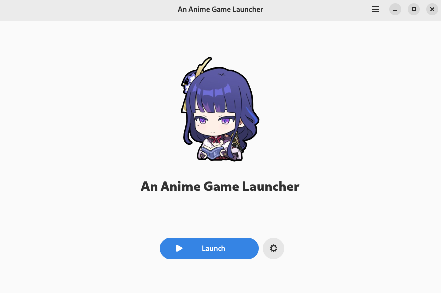
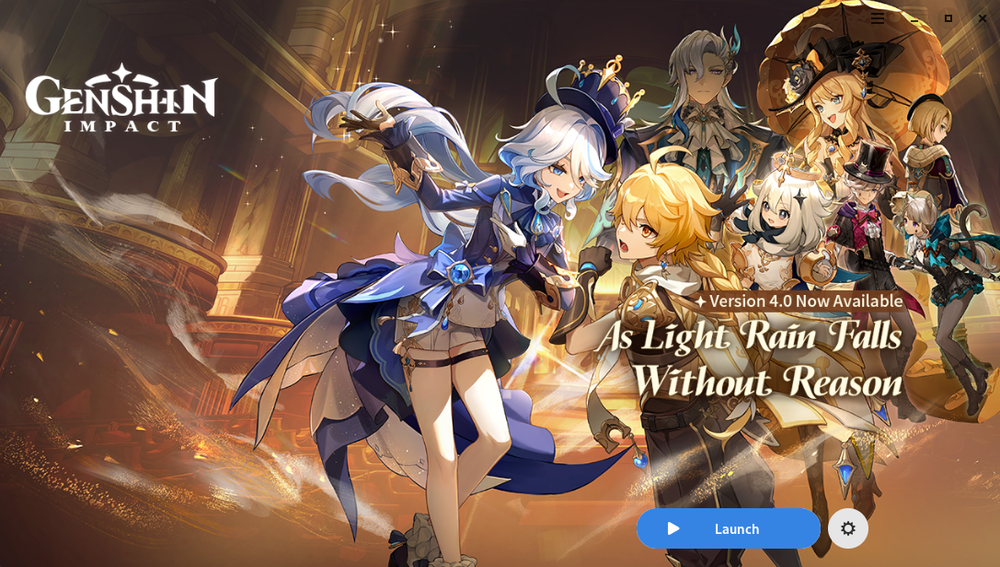
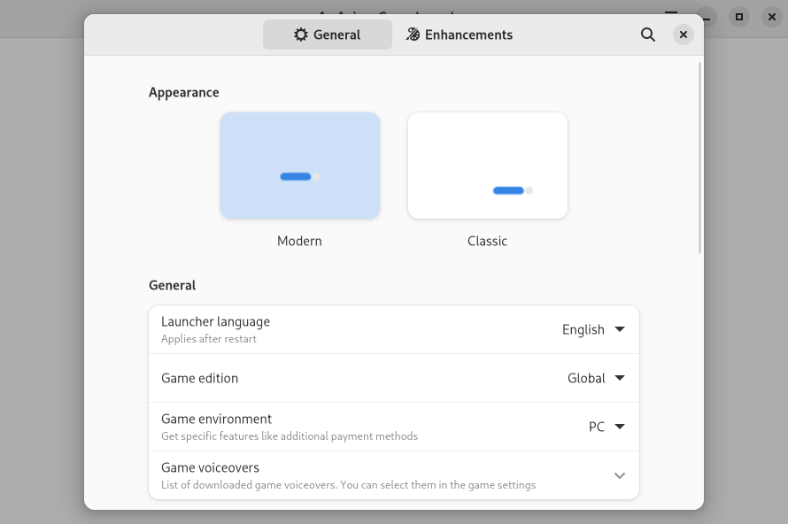
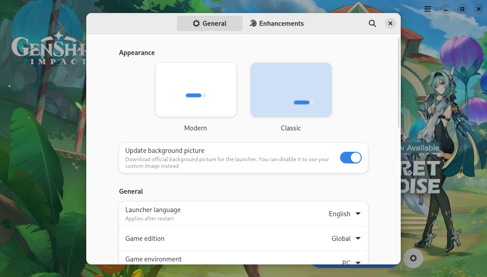

# an-anime-game-launcher-eopkg
> [!WARNING]
> **An Anime Game Launcher is a project by An Anime Team. I have no direct connection or communication with the project managers.**

| Modern style | Classic style |
| :-: | :-: |
| <picture><source media="(prefers-color-scheme: dark)" srcset="repository/main-modern-dark.png"></picture> | <picture><source media="(prefers-color-scheme: dark)" srcset="repository/main-classic-dark.png"></picture> |
| <picture><source media="(prefers-color-scheme: dark)" srcset="repository/settings-modern-dark.png"></picture> | <picture><source media="(prefers-color-scheme: dark)" srcset="repository/settings-classic-dark.png"></picture> |

<p align="center">
    <a href="https://discord.gg/ck37X6UWBp">Discord</a> ·
    <a href="https://zulip.dawn.wine">Zulip</a> ·
    <a href="https://github.com/an-anime-team/an-anime-game-launcher/wiki">Wiki</a>
</p>

# ⬇️ Download

## EOPKG
```bash
sudo eopkg install https://github.com/kayrakrh/an-anime-game-launcher-eopkg/releases/download/v3.19.7/an-anime-game-launcher-3.19.7-4-1-x86_64.eopkg
```

## 😀 Official support

These packages are officially supported by the An Anime Team

| Format | Wiki | Source | Distributions | Maintainer |
| - | - | - | - | - |
| Flatpak | [wiki](https://github.com/an-anime-team/an-anime-game-launcher/wiki/Installation#-any-distribution-flatpak) | [Flathub](https://flathub.org/apps/moe.launcher.an-anime-game-launcher) | Any (Fedora, Pop!_OS, SteamOS / Steam Deck, etc.) | NelloKudo |

## 🙂 Community support

These packages are supported by active members of AAGL community

| Format | Wiki | Source | Distributions | Maintainer |
| - | - | - | - | - |
| AUR | [wiki](https://github.com/an-anime-team/an-anime-game-launcher/wiki/Installation#-arch-linux-aur) | [an-anime-game-launcher-bin](https://aur.archlinux.org/packages/an-anime-game-launcher-bin) | Arch Linux, Manjaro, EndeavourOS | xstra * |
| NixOS module | [wiki](https://github.com/an-anime-team/an-anime-game-launcher/wiki/Installation#-nixos-nixpkg) | [aagl-gtk-on-nix](https://github.com/ezKEa/aagl-gtk-on-nix) | NixOS | Luxxy * |
| Ebuild | [wiki](https://github.com/an-anime-team/an-anime-game-launcher/wiki/Installation#gentoo) | [aagl-ebuilds](https://github.com/an-anime-team/gentoo-ebuilds) * | Gentoo | johnthecoolingfan * |

## 😑 Third party support

These packages are supported by third party distributors. They either did not contact us, or contact exceptionally rarely. We do not verify state of these packages, and we are not related to their state at all.

| Format | Source | Distributions |
| - | - | - |
| DEB | [an-anime-game-launcher](https://launchpad.net/~thundergemios10/+archive/ubuntu/an-anime-game-launcher) | Ubuntu, Linux Mint, Pop!_OS |
| Pacstall | [an-anime-game-launcher-bin](https://pacstall.dev/packages/an-anime-game-launcher-bin) | Ubuntu |

EOPKG is here too
